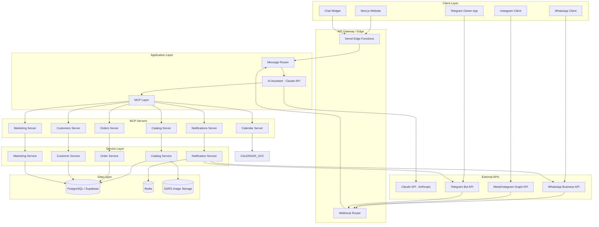
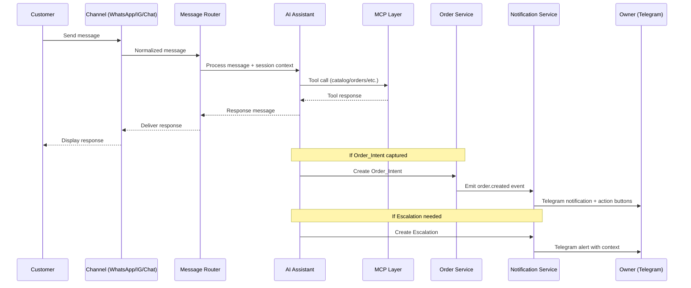
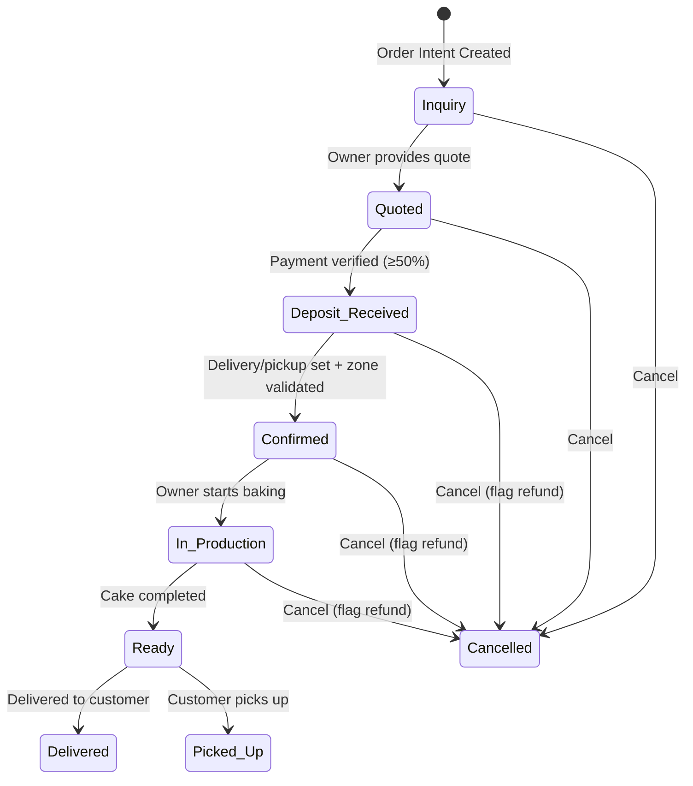
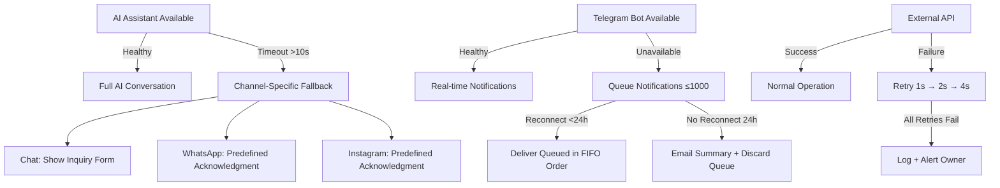

# Design Document: La La Sweett Sales System

## Overview

The La La Sweett Sales System is an AI-assisted sales and operations platform for a custom cakes bakery in Austin, TX. The system automates customer interactions across multiple channels (website chat, WhatsApp, Instagram DMs), manages the full order lifecycle from inquiry to delivery, provides the owner with real-time notifications and analytics via Telegram, and optimizes a $100/month marketing budget.

The architecture follows a channel-agnostic design where all customer messages—regardless of origin—flow through a unified AI Assistant powered by Claude, backed by structured data services exposed via an MCP (Model Context Protocol) layer. This ensures consistent brand voice, knowledge accuracy, and order capture across all touchpoints.

### Key Design Decisions

1. **Channel-agnostic message router**: All inbound messages are normalized into a common format before reaching the AI Assistant, enabling consistent behavior across WhatsApp, Instagram, and the website chat widget.
2. **MCP Layer as the single source of truth**: The AI Assistant accesses all business data (catalog, orders, customers, calendar) exclusively through MCP tools, preventing hallucination and ensuring data consistency.
3. **Event-driven notification pipeline**: Order state transitions and escalations emit events that are consumed by the notification service, decoupling business logic from delivery channels.
4. **PostgreSQL + Redis hybrid data layer**: PostgreSQL (via Supabase) for durable relational data; Redis for session state, rate limiting, and notification queues.
5. **Next.js App Router for SSR/ISR catalog pages**: Static generation with incremental revalidation for catalog pages ensures fast load times and SEO while keeping content fresh.

---

## Architecture

### High-Level Architecture Diagram



### Message Flow Sequence



---

## Components and Interfaces

### 1. Next.js Website (Frontend)

**Responsibility**: Public-facing storefront, catalog display, order inquiry forms, chat widget host, SEO optimization.

**Technology**: Next.js 14+ (App Router), Tailwind CSS v3.4+, deployed on Vercel.

**Key Interfaces**:
- `GET /` — Homepage with hero, featured cakes, CTA
- `GET /cakes/[category]` — Category gallery pages (ISR)
- `GET /policies` — Business policies page
- `GET /order` — Order inquiry form
- `GET /api/catalog.json` — Public catalog JSON endpoint
- `GET /sitemap.xml` — Dynamic sitemap
- `GET /robots.txt` — Robots configuration
- WebSocket / SSE connection for Chat Widget real-time messaging

### 2. Message Router

**Responsibility**: Normalizes inbound messages from all channels into a unified format, routes to AI Assistant, delivers responses back to originating channel.

**Interface**:
```typescript
interface InboundMessage {
  id: string;
  channel: 'whatsapp' | 'instagram' | 'chat_widget';
  senderId: string;
  senderName?: string;
  content: string;
  timestamp: Date;
  metadata: Record<string, unknown>;
}

interface OutboundMessage {
  channel: 'whatsapp' | 'instagram' | 'chat_widget';
  recipientId: string;
  content: string;
  metadata?: Record<string, unknown>;
}

interface MessageRouter {
  handleInbound(message: InboundMessage): Promise<OutboundMessage>;
  deliverResponse(message: OutboundMessage): Promise<void>;
}
```

### 3. AI Assistant

**Responsibility**: Conversational AI agent using Claude API that answers customer queries, captures order intents, and escalates complex requests.

**Interface**:
```typescript
interface AIAssistantConfig {
  systemPrompt: string;       // Brand voice + behavior rules
  mcpTools: MCPToolSet;       // Available MCP tools
  maxResponseTime: number;    // 5000ms default
  sessionTimeout: number;     // 30 minutes
}

interface ConversationSession {
  sessionId: string;
  channel: string;
  customerId: string;
  messages: Message[];
  capturedIntent?: Partial<OrderIntent>;
  createdAt: Date;
  lastActivityAt: Date;
}

interface AIAssistant {
  processMessage(session: ConversationSession, message: InboundMessage): Promise<AIResponse>;
}

interface AIResponse {
  content: string;
  actions?: AIAction[];  // e.g., create_order_intent, escalate, capture_field
}
```

### 4. MCP Layer

**Responsibility**: Provides structured tool access for the AI Assistant to query and mutate business data without direct database access.

**MCP Servers**:

| Server | Tools |
|--------|-------|
| Catalog | `get_categories`, `get_products`, `get_product_by_id`, `search_products`, `get_flavors`, `get_pricing_range`, `calculate_servings` |
| Orders | `create_order_intent`, `get_order_status`, `update_order_state`, `get_orders_by_customer`, `validate_delivery_zone` |
| Customers | `get_customer`, `create_customer`, `update_customer`, `delete_customer_pii` |
| Calendar | `check_availability`, `get_lead_time`, `get_booked_dates` |
| Notifications | `send_owner_notification`, `send_customer_message`, `create_escalation` |
| Marketing | `get_channel_metrics`, `get_budget_allocation`, `generate_content_suggestions` |

### 5. Order Service

**Responsibility**: Manages order lifecycle, state transitions, validation, and audit logging.

**Interface**:
```typescript
interface OrderService {
  createOrderIntent(data: OrderIntentData): Promise<OrderIntent>;
  transitionState(orderId: string, newState: OrderState, context: TransitionContext): Promise<Order>;
  getOrder(orderId: string): Promise<Order>;
  getOrdersByCustomer(customerId: string): Promise<Order[]>;
  cancelOrder(orderId: string, reason: string): Promise<Order>;
  verifyDeposit(orderId: string, amount: number): Promise<DepositVerification>;
}

type OrderState = 
  | 'Inquiry' 
  | 'Quoted' 
  | 'Deposit_Received' 
  | 'Confirmed' 
  | 'In_Production' 
  | 'Ready' 
  | 'Delivered' 
  | 'Picked_Up' 
  | 'Cancelled';

interface TransitionContext {
  triggeredBy: string;
  timestamp: Date;
  metadata?: Record<string, unknown>;
}
```

### 6. Catalog Service

**Responsibility**: Manages product data, categories, pricing, flavors, and availability.

**Interface**:
```typescript
interface CatalogService {
  getCategories(): Promise<Category[]>;
  getProductsByCategory(categorySlug: string, page: number, pageSize: number): Promise<PaginatedProducts>;
  getProduct(productId: string): Promise<Product>;
  searchProducts(query: string): Promise<Product[]>;
  getFlavors(): Promise<Flavor[]>;
  calculateServings(guestCount: number): Promise<ServingsRecommendation>;
  getFullCatalog(): Promise<CatalogJSON>;
}
```

### 7. Notification Service

**Responsibility**: Delivers notifications to owner (Telegram) and customers (WhatsApp/email), manages notification queuing and retry logic.

**Interface**:
```typescript
interface NotificationService {
  notifyOwner(notification: OwnerNotification): Promise<void>;
  notifyCustomer(notification: CustomerNotification): Promise<void>;
  queueNotification(notification: QueuedNotification): Promise<void>;
  processQueue(): Promise<void>;
  sendDailySummary(): Promise<void>;
}

interface OwnerNotification {
  type: 'new_order' | 'escalation' | 'unresponded_alert' | 'daily_summary';
  content: string;
  actions?: TelegramInlineButton[];
  priority: 'high' | 'normal';
}
```

### 8. Marketing Service

**Responsibility**: Budget allocation recommendations, ROI tracking, conversion attribution, content planning, and analytics.

**Interface**:
```typescript
interface MarketingService {
  generateBudgetAllocation(): Promise<BudgetAllocation>;
  trackConversion(customerId: string, channel: string): Promise<void>;
  getROIMetrics(month: string): Promise<ChannelROI[]>;
  generateSeasonalRecommendations(): Promise<Recommendation[]>;
  getWeeklyAnalytics(): Promise<WeeklyReport>;
  generateContentSuggestions(count: number): Promise<ContentSuggestion[]>;
  sendReviewSolicitation(orderId: string): Promise<void>;
}
```

### 9. WhatsApp Integration

**Responsibility**: Webhook handling for inbound WhatsApp messages, outbound message delivery, rate limiting.

**Interface**:
```typescript
interface WhatsAppIntegration {
  handleWebhook(payload: WhatsAppWebhookPayload): Promise<void>;
  sendMessage(recipientPhone: string, content: string): Promise<void>;
  sendTemplate(recipientPhone: string, templateName: string, params: Record<string, string>): Promise<void>;
}
```

### 10. Instagram Integration

**Responsibility**: DM handling, comment monitoring, keyword detection, content planning delivery.

**Interface**:
```typescript
interface InstagramIntegration {
  handleDMWebhook(payload: InstagramDMPayload): Promise<void>;
  handleCommentWebhook(payload: InstagramCommentPayload): Promise<void>;
  sendDM(recipientId: string, content: string): Promise<void>;
  replyToComment(commentId: string, content: string): Promise<void>;
  generateWeeklyContentPlan(): Promise<ContentPlan>;
}
```

### 11. Telegram Bot

**Responsibility**: Owner notifications, inline action buttons, daily summaries, content command handling.

**Interface**:
```typescript
interface TelegramBot {
  sendNotification(notification: OwnerNotification): Promise<void>;
  handleCommand(command: TelegramCommand): Promise<void>;
  handleCallbackQuery(query: TelegramCallbackQuery): Promise<void>;
  sendDailySummary(summary: DailySummary): Promise<void>;
}
```

---

## Data Models

### Entity Relationship Diagram

```mermaid
erDiagram
    Customer ||--o{ Order : places
    Customer ||--o{ Conversation : has
    Customer ||--o{ ConsentRecord : has
    Order ||--o{ OrderStateTransition : tracks
    Order }o--|| Product : references
    Product }o--|| Category : belongs_to
    Product ||--o{ ProductFlavor : has
    Conversation ||--o{ Message : contains
    Conversation ||--o{ Escalation : triggers
    MarketingAttribution ||--|| Customer : tracks
    MarketingChannel ||--o{ MarketingAttribution : sources

    Customer {
        uuid id PK
        string name
        string email
        string phone
        string delivery_address
        boolean marketing_consent
        timestamp consent_timestamp
        string consent_channel
        timestamp created_at
        timestamp updated_at
    }

    Category {
        uuid id PK
        string name
        string slug
        string description
        int sort_order
        boolean active
    }

    Product {
        uuid id PK
        uuid category_id FK
        string name
        string description_short
        decimal price_min
        decimal price_max
        int min_servings
        int max_servings
        int lead_time_days
        string image_url
        jsonb allergen_tags
        jsonb structured_data
        boolean active
        timestamp created_at
    }

    ProductFlavor {
        uuid id PK
        uuid product_id FK
        string flavor_name
        boolean available
    }

    Order {
        uuid id PK
        uuid customer_id FK
        string state
        date event_date
        int servings
        string flavor_preference
        text design_description
        string budget_range
        decimal quoted_price
        decimal deposit_amount
        string delivery_preference
        string delivery_address
        string originating_channel
        string cancellation_reason
        boolean refund_flagged
        timestamp created_at
        timestamp updated_at
    }

    OrderStateTransition {
        uuid id PK
        uuid order_id FK
        string from_state
        string to_state
        string triggered_by
        text metadata
        timestamp created_at
    }

    Conversation {
        uuid id PK
        uuid customer_id FK
        string channel
        string session_id
        string[] intent_tags
        string status
        timestamp started_at
        timestamp last_activity_at
    }

    Message {
        uuid id PK
        uuid conversation_id FK
        string role
        text content
        timestamp created_at
    }

    Escalation {
        uuid id PK
        uuid conversation_id FK
        string reason
        text context_summary
        string originating_channel
        string status
        timestamp created_at
        timestamp resolved_at
    }

    ConsentRecord {
        uuid id PK
        uuid customer_id FK
        string consent_type
        boolean granted
        string channel
        timestamp recorded_at
    }

    MarketingChannel {
        uuid id PK
        string name
        decimal monthly_budget
        string channel_type
    }

    MarketingAttribution {
        uuid id PK
        uuid customer_id FK
        uuid channel_id FK
        string referral_source
        timestamp first_interaction
        timestamp attributed_at
    }

    Notification {
        uuid id PK
        string type
        string recipient_type
        string recipient_id
        text content
        jsonb actions
        string status
        int retry_count
        timestamp created_at
        timestamp delivered_at
    }
}
```

### Order State Machine



### Key Data Constraints

| Field | Constraint |
|-------|-----------|
| `Customer.name` | Max 100 chars |
| `Customer.email` | Max 254 chars, valid email format |
| `Customer.phone` | Max 20 chars, digits only |
| `Product.description_short` | Max 150 chars |
| `Order.design_description` | Max 1000 chars (form), 500 chars (WhatsApp) |
| `Order.servings` | 10–500 (form), 1–500 (AI calculator) |
| `Order.event_date` | Minimum 7 days from current date |
| `Escalation.context_summary` | Max 500 chars |
| `Message.content` | Max 2000 chars |


## Correctness Properties

*A property is a characteristic or behavior that should hold true across all valid executions of a system — essentially, a formal statement about what the system should do. Properties serve as the bridge between human-readable specifications and machine-verifiable correctness guarantees.*

### Property 1: Pagination Correctness

*For any* number of products N in a category and page size of 12, the total pages should equal ⌈N/12⌉, each page (except possibly the last) should contain exactly 12 items, and every product should appear on exactly one page.

**Validates: Requirements 1.2**

### Property 2: Product Listing Completeness

*For any* product in the catalog, the rendered listing must contain the product name, category, at least one photo URL, a starting price in "$X – $Y" format, and a description of at most 150 characters.

**Validates: Requirements 1.3**

### Property 3: JSON-LD Product Validity

*For any* product rendered on the website, the generated JSON-LD structured data must be valid schema.org/Product containing name, description, price, and image fields.

**Validates: Requirements 1.6, 5.6**

### Property 4: Order Form Missing Field Validation

*For any* order inquiry form submission where at least one required field (date, servings, flavor, description, budget, name, email, phone) is missing, the system must reject the submission and return a validation error specifying each missing field.

**Validates: Requirements 2.3**

### Property 5: Minimum Lead Time Enforcement

*For any* date value, order inquiry submission should be rejected if and only if the date is less than 7 calendar days from the current date.

**Validates: Requirements 2.4**

### Property 6: Order Intent Creation from Complete Intake

*For any* complete set of order details (event date, servings, flavor, design description, budget range) submitted from any channel (Website, WhatsApp, Instagram, Chat), the Order_Service must create an Order_Intent record containing all provided fields.

**Validates: Requirements 2.2, 7.5, 9.3**

### Property 7: AI Response Data Accuracy

*For any* customer query about products, pricing, or availability, every factual claim in the AI_Assistant's response must be traceable to data currently in the Catalog_Service — no information may be fabricated.

**Validates: Requirements 6.3, 6.4, 7.3**

### Property 8: Escalation Trigger Correctness

*For any* customer message that matches escalation criteria (multi-tier >5, sculpted 3D elements, designs not in catalog categories, pricing beyond listed ranges, or explicit request for human contact), the system must create an Escalation or Handoff record and notify the Owner.

**Validates: Requirements 6.5, 7.6**

### Property 9: Order Intent Detection Threshold

*For any* conversation where the customer has provided at least 2 of the 5 order detail fields (event date, servings, flavor preference, design description, budget range), the AI_Assistant must capture a structured Order_Intent and confirm the details back to the customer.

**Validates: Requirements 6.6**

### Property 10: Servings Calculator

*For any* guest count between 1 and 500, the servings calculator must return a recommended number of servings ≥ the guest count and a valid tier configuration from the Catalog_Service portion data.

**Validates: Requirements 6.7**

### Property 11: Budget Allocation Sum Constraint

*For any* monthly budget allocation generated by the Marketing_System, the sum of all channel amounts must equal exactly $100.00, and every defined channel (Meta Ads, Google local search, boosted Instagram posts, organic content, review generation) must have a non-negative allocation.

**Validates: Requirements 10.1**

### Property 12: Conversion Attribution Window

*For any* customer interaction, attribution to a marketing channel is valid if and only if the customer's first interaction occurred within 30 days of the attributed conversion event.

**Validates: Requirements 10.2**

### Property 13: ROI Metrics Calculation

*For any* channel with actual spend S, inquiry count I, and order count O in a given month: cost-per-inquiry = S/I (or undefined if I=0) and cost-per-order = S/O (or undefined if O=0). If I < 5, the channel must be flagged as "insufficient data."

**Validates: Requirements 10.4, 10.6**

### Property 14: Review Solicitation Idempotency

*For any* order that transitions to Delivered/Picked_Up state, exactly one review solicitation message must be generated — never zero, never more than one.

**Validates: Requirements 10.5**

### Property 15: Input Validation Enforcement

*For any* form input, the system must reject: names exceeding 100 characters, emails exceeding 254 characters or not matching email format, phone numbers exceeding 20 characters or containing non-digit characters, text fields exceeding 2000 characters, and any text containing script tags. Valid inputs within these constraints must be accepted.

**Validates: Requirements 11.1, 11.7**

### Property 16: Rate Limiting

*For any* message source, messages exceeding the configured rate (20/minute for WhatsApp per phone number, 10/minute for Chat per session) must be rejected, and messages within the rate must be accepted.

**Validates: Requirements 11.3, 11.4**

### Property 17: Marketing Consent Gate

*For any* customer, marketing messages (WhatsApp or email) must be sent if and only if the customer has an active opt-in consent record with a recorded timestamp and channel. Customers without consent or with withdrawn consent must receive no marketing messages.

**Validates: Requirements 11.6, 15.3, 15.6**

### Property 18: Notification Queue Capacity

*For any* sequence of notifications during a Telegram outage, the queue must accept up to 1000 notifications in order. Notifications beyond 1000 must be handled via the email fallback path.

**Validates: Requirements 12.3**

### Property 19: Retry with Exponential Backoff

*For any* failed external API call (WhatsApp, Instagram, Telegram), the system must retry exactly 3 times with intervals of 1s, 2s, and 4s (exponential backoff from 1s base). If all retries fail, an alert must be generated.

**Validates: Requirements 12.6**

### Property 20: Order State Machine Valid Transitions

*For any* order in state S and attempted action A, the transition must succeed if and only if (S, A) is in the set of valid transitions: {(Inquiry, quote), (Quoted, receive_deposit), (Deposit_Received, confirm), (Confirmed, start_production), (In_Production, mark_ready), (Ready, complete), (any except Delivered_Picked_Up, cancel)}.

**Validates: Requirements 13.1**

### Property 21: State Transition Audit

*For any* successful order state transition, the system must create an audit record containing the previous state, new state, triggering action, actor ID, and timestamp.

**Validates: Requirements 13.2**

### Property 22: Delivery Zone Validation

*For any* order transitioning to Confirmed with delivery preference "delivery," the delivery address must be within the Austin metro zone. If outside, the transition must be rejected and the order retained in Deposit_Received state.

**Validates: Requirements 13.4, 13.5**

### Property 23: Deposit Verification

*For any* payment amount P and quoted price Q, the transition from Quoted to Deposit_Received must succeed if and only if P ≥ Q/2 (50% minimum deposit).

**Validates: Requirements 13.6, 13.7**

### Property 24: Cancellation Refund Flagging

*For any* order cancelled from Deposit_Received, Confirmed, or In_Production state, the order must be flagged for refund review. Orders cancelled from Inquiry or Quoted state must not be flagged.

**Validates: Requirements 13.8**

### Property 25: Conversation Message Logging

*For any* message processed by the AI_Assistant, a log entry must exist containing timestamp, channel source, customer identifier, message role (customer/assistant), and content.

**Validates: Requirements 14.1**

### Property 26: Customer Data Minimization

*For any* customer record persisted by the Order_Service, only the following fields may be stored: name, email, phone, delivery address (if applicable), and order-related details. No additional fields from the input may be persisted.

**Validates: Requirements 15.2**

### Property 27: Data Deletion Correctness

*For any* customer data deletion request, all PII (name, email, phone, delivery address) must be removed from the customer record while order records are retained with anonymized references.

**Validates: Requirements 15.4**

### Property 28: Instagram Keyword Detection

*For any* Instagram DM containing at least one cake-related keyword (cake, order, price, custom, birthday, wedding, cupcake, dessert, book, quote), the message must be routed to the AI_Assistant. *For any* comment containing a purchase-intent keyword (order, price, how much, available, book) as a case-insensitive whole word, an auto-reply must be triggered.

**Validates: Requirements 9.1, 9.2**

### Property 29: Allergen Tag Display

*For any* product with allergen accommodation tags in the Catalog_Service, all applicable allergen options must be displayed on the product listing.

**Validates: Requirements 3.2**

### Property 30: Seasonal Recommendation Timing

*For any* known Austin-area event date, the Marketing_System must generate promotion recommendations at least 28 days (4 weeks) before that event date.

**Validates: Requirements 10.3**

## Error Handling

### Strategy by Component

| Component | Error Type | Handling Strategy |
|-----------|-----------|-------------------|
| AI_Assistant | Claude API timeout (>10s) | Fallback to predefined message per channel; show inquiry form on website |
| AI_Assistant | Claude API rate limit | Queue message, retry after cooldown; notify owner if sustained |
| Catalog_Service | Database connection failure | Serve from Redis cache (stale data); log error |
| Order_Service | State transition violation | Return descriptive error to caller; no state change; log attempt |
| WhatsApp_Integration | API error | Retry 3x exponential backoff; fallback to owner notification |
| Instagram_Integration | API error | Retry 3x exponential backoff; skip and log if exhausted |
| Telegram_Bot | Delivery failure | Queue to Redis (max 1000); email fallback after 24h |
| Marketing_System | Insufficient data | Flag metrics as insufficient; proceed with available data |
| Notification_Service | Queue overflow (>1000) | Email fallback; discard oldest after email sent |

### Error Response Format

All API errors return a consistent structure:

```typescript
interface APIError {
  error: {
    code: string;           // e.g., "VALIDATION_FAILED", "RATE_LIMITED"
    message: string;        // Human-readable, no internal details
    fields?: {              // For validation errors
      field: string;
      reason: string;
    }[];
    retryAfter?: number;    // Seconds until retry (for rate limits)
  };
}
```

### Circuit Breaker Pattern

External APIs (WhatsApp, Instagram, Telegram, Claude) use a circuit breaker:
- **Closed**: Normal operation
- **Open**: After 5 consecutive failures within 1 minute → all calls fail immediately for 30s
- **Half-Open**: After 30s, allow one probe request; success → Closed, failure → Open

### Graceful Degradation Hierarchy

1. **Full operation**: All services healthy
2. **AI degraded**: Predefined responses + inquiry form fallback
3. **Channel degraded**: Messages queued; owner notified via working channels
4. **Notification degraded**: Queue → email fallback
5. **Database degraded**: Read from Redis cache; writes queued

## Testing Strategy

### Dual Testing Approach

This system combines **property-based tests** for logic-heavy components and **example-based tests** for integration points and UI behavior.

### Property-Based Testing

**Library**: [fast-check](https://github.com/dubzzz/fast-check) for TypeScript/Node.js

**Configuration**:
- Minimum 100 iterations per property test
- Each test tagged with: `Feature: la-la-sweett-sales-system, Property {N}: {description}`

**Key PBT Targets**:

| Component | Properties Tested |
|-----------|-------------------|
| Order State Machine | Properties 20, 21, 22, 23, 24 |
| Input Validation | Properties 4, 5, 15, 16 |
| Catalog/Product | Properties 1, 2, 3, 29 |
| Marketing | Properties 11, 12, 13, 14, 30 |
| AI/Conversation | Properties 7, 8, 9, 10, 25 |
| Privacy/Consent | Properties 17, 26, 27 |
| Infrastructure | Properties 18, 19 |
| Instagram | Property 28 |

### Example-Based Unit Tests

**Framework**: Vitest

**Coverage Targets**:
- Fallback behaviors (AI timeout → form, predefined messages)
- Channel-specific rendering (Chat Widget placement, mobile nav)
- Static content pages (policies, privacy)
- Telegram bot commands (/content, /analytics)
- CSRF token validation
- SEO markup presence (robots.txt, sitemap structure)

### Integration Tests

**Framework**: Vitest + Supertest for API testing, Playwright for E2E

**Coverage**:
- Order creation flow end-to-end (form → Order_Intent → Telegram notification)
- WhatsApp webhook → AI response → reply delivery
- Instagram DM → keyword detection → AI routing → response
- Telegram inline button callbacks (approve/reject/reply)
- Daily summary generation and delivery
- Data deletion flow (request → acknowledgment → PII removal)

### Performance/Load Tests

**Framework**: k6

**Scenarios**:
- 50 concurrent sessions sustained for 5 minutes (Requirement 12.5)
- Catalog page load time <3s under load
- API response time <1s at p95

### Accessibility Tests

**Tools**: axe-core (automated) + manual screen reader testing

**Coverage**:
- All public pages pass axe-core with zero violations at AA level
- Touch targets ≥ 44x44px verified
- Color contrast ratios validated against brand palette


## Correctness Properties

*A property is a characteristic or behavior that should hold true across all valid executions of a system — essentially, a formal statement about what the system should do. Properties serve as the bridge between human-readable specifications and machine-verifiable correctness guarantees.*

### Property 1: Product price formatting

*For any* product with a price_min and price_max, the formatted price string SHALL match the pattern "$X – $Y" where X and Y are numeric values with X ≤ Y.

**Validates: Requirements 1.2**

### Property 2: Product listing completeness and description constraint

*For any* product in the catalog, the rendered listing SHALL include product name, category, photo URL, starting price, and a description of at most 150 characters.

**Validates: Requirements 1.3**

### Property 3: JSON-LD Product markup validity

*For any* product rendered on the website, the generated JSON-LD SHALL conform to schema.org/Product schema including required fields (name, description, offers with price and priceCurrency).

**Validates: Requirements 1.6**

### Property 4: Input validation enforcement

*For any* form input data, the validation function SHALL reject inputs where: name exceeds 100 characters, email exceeds 254 characters or doesn't match valid email format, phone exceeds 20 characters or contains non-digit characters, text fields exceed 2000 characters, or any field contains script tags. Valid inputs conforming to all constraints SHALL be accepted.

**Validates: Requirements 2.1, 11.1**

### Property 5: Missing field error mapping

*For any* form submission with a non-empty subset of required fields missing, the validation response SHALL contain error messages for exactly the set of missing fields — no more, no fewer.

**Validates: Requirements 2.3**

### Property 6: Minimum lead time enforcement

*For any* date value, the date validation function SHALL reject dates less than 7 days from the current date and accept dates 7 or more days from the current date.

**Validates: Requirements 2.4**

### Property 7: Allergen tag display completeness

*For any* product with allergen accommodation tags in the catalog, the rendered product listing SHALL display all allergen options associated with that product.

**Validates: Requirements 3.2**

### Property 8: Sitemap completeness

*For any* set of active public pages in the system, the generated sitemap.xml SHALL contain a URL entry for every page in that set and no entries for removed/inactive pages.

**Validates: Requirements 5.1**

### Property 9: Meta tag length and keyword constraints

*For any* page with a defined primary keyword, the generated meta title SHALL be at most 60 characters and contain the primary keyword, and the generated meta description SHALL be at most 160 characters and contain the primary keyword.

**Validates: Requirements 5.5**

### Property 10: Catalog JSON structural validity

*For any* product serialized to the /api/catalog.json endpoint, the output SHALL contain numeric (non-string) price fields, unit indicators, and constraint fields (minimum servings as integer, lead time in days as integer, available flavors as an array of enumerated values).

**Validates: Requirements 5.6**

### Property 11: Escalation trigger classification

*For any* design request description, the escalation detection function SHALL trigger an escalation if and only if the request involves: multi-tier structures above 5 tiers, sculpted 3D elements, designs not represented in catalog categories, or pricing beyond listed ranges.

**Validates: Requirements 6.5, 7.6**

### Property 12: Order intent capture threshold

*For any* set of order detail fields (event date, servings, flavor preference, design description, budget range), the intent capture logic SHALL activate when 2 or more fields are provided, and SHALL NOT activate when fewer than 2 fields are provided.

**Validates: Requirements 6.6**

### Property 13: Servings calculator monotonicity and bounds

*For any* guest count between 1 and 500, the servings calculator SHALL return a recommended servings value that is: (a) at least equal to the guest count, (b) monotonically non-decreasing as guest count increases, and (c) accompanied by a valid tier configuration from the portion data.

**Validates: Requirements 6.7**

### Property 14: Escalation summary length constraint

*For any* conversation history, the generated escalation summary SHALL be at most 500 characters while containing the reason for escalation and originating channel.

**Validates: Requirements 8.2**

### Property 15: Instagram DM keyword routing

*For any* Instagram DM message text, the routing function SHALL route to the AI assistant if the text contains any of the cake-related keywords (cake, order, price, custom, birthday, wedding, cupcake, dessert, book, quote) matched case-insensitively.

**Validates: Requirements 9.1**

### Property 16: Instagram comment purchase-intent detection

*For any* Instagram comment text, the purchase-intent detection function SHALL return true if and only if the text contains one or more purchase-intent keywords (order, price, how much, available, book) matched case-insensitively as whole words.

**Validates: Requirements 9.2**

### Property 17: Budget allocation invariant

*For any* set of active marketing channels and historical performance data, the generated monthly budget allocation SHALL assign a positive dollar amount to each active channel and the sum of all allocations SHALL equal exactly $100.00.

**Validates: Requirements 10.1**

### Property 18: Attribution window enforcement

*For any* customer interaction, marketing attribution SHALL be assigned to a channel only if the customer's first interaction occurred within 30 days of the current attribution evaluation. Interactions outside the 30-day window SHALL NOT receive attribution.

**Validates: Requirements 10.2**

### Property 19: Seasonal recommendation timing

*For any* known Austin-area event date and current date, the seasonal recommendation system SHALL generate recommendations when the current date is at least 4 weeks before the event date and SHALL NOT generate recommendations when the current date is less than 4 weeks before the event date.

**Validates: Requirements 10.3**

### Property 20: ROI calculation correctness

*For any* channel with actual spend amount S, inquiry count I > 0, and order count O > 0, the cost-per-inquiry SHALL equal S/I and cost-per-order SHALL equal S/O. When I = 0 or O = 0, the respective metric SHALL be undefined/null rather than zero or infinity.

**Validates: Requirements 10.4**

### Property 21: Review solicitation uniqueness

*For any* order, at most one review solicitation SHALL be generated. Attempting to create a second solicitation for the same order SHALL be rejected.

**Validates: Requirements 10.5**

### Property 22: Insufficient data threshold flag

*For any* marketing channel's monthly report, the insufficient-data flag SHALL be set to true if and only if the channel has fewer than 5 attributed inquiries in that month.

**Validates: Requirements 10.6**

### Property 23: Rate limiting sliding window

*For any* sequence of messages from a single source (session or phone number), the rate limiter SHALL allow at most N messages within any 1-minute sliding window (where N=10 for chat sessions, N=20 for WhatsApp phone numbers) and reject messages exceeding the limit.

**Validates: Requirements 11.3, 11.4**

### Property 24: Marketing consent gate

*For any* customer, the marketing message send function SHALL succeed only if the customer has an active consent record (granted=true, not withdrawn) for the specific communication type. Customers without consent or with withdrawn consent SHALL NOT receive marketing messages.

**Validates: Requirements 11.6, 15.6**

### Property 25: Validation error response safety

*For any* server-side validation failure, the error response SHALL include field names and human-readable reasons for failure, and SHALL NOT contain stack traces, internal file paths, database query details, or system configuration information.

**Validates: Requirements 11.7**

### Property 26: Notification queue bounds and ordering

*For any* sequence of notifications enqueued while Telegram is unavailable, the queue SHALL accept at most 1000 notifications (rejecting or flushing to email beyond that limit) and SHALL deliver queued notifications in FIFO order when the connection is restored.

**Validates: Requirements 12.3**

### Property 27: Retry with exponential backoff

*For any* failed external API call, the retry mechanism SHALL attempt exactly 3 retries with delays following exponential backoff (1s, 2s, 4s) and SHALL alert the owner if all retries fail.

**Validates: Requirements 12.6**

### Property 28: Order state machine transition validity

*For any* order in a given state and any attempted transition action, the state machine SHALL allow the transition only if it follows the defined progression (Inquiry→Quoted→Deposit_Received→Confirmed→In_Production→Ready→Delivered/Picked_Up) or is a cancellation from any state except Delivered/Picked_Up. Invalid transitions SHALL be rejected without modifying the order state.

**Validates: Requirements 13.1**

### Property 29: Transition audit completeness

*For any* successful state transition, the system SHALL create an audit record containing the from-state, to-state, timestamp, and triggering action. No successful transition SHALL lack an audit record.

**Validates: Requirements 13.2**

### Property 30: Deposit minimum validation

*For any* order in Quoted state with quoted_price P and deposit attempt amount D, the transition to Deposit_Received SHALL succeed if and only if D ≥ P × 0.50.

**Validates: Requirements 13.6, 13.7**

### Property 31: Cancellation refund flag

*For any* order cancelled from Deposit_Received, Confirmed, or In_Production state, the system SHALL set refund_review_needed to true. Orders cancelled from Inquiry or Quoted state SHALL NOT have refund_review_needed set to true.

**Validates: Requirements 13.8**

### Property 32: Message log completeness

*For any* message processed by the AI assistant, the log record SHALL contain a timestamp, channel source, and customer identifier. No processed message SHALL lack any of these fields.

**Validates: Requirements 14.1**

### Property 33: Customer data deletion with anonymized retention

*For any* customer data deletion request, the system SHALL remove all personally identifiable information (name, email, phone, delivery address) from the customer record while retaining associated order records with anonymized customer references.

**Validates: Requirements 15.4**

### Property 34: PII storage minimization

*For any* customer record stored by the Order Service, the persisted data SHALL contain only the allowed fields: name, email, phone, delivery address (if applicable), and order-related details. No additional PII beyond these fields SHALL be stored.

**Validates: Requirements 15.2**

## Error Handling

### Strategy by Layer

| Layer | Error Type | Handling |
|-------|-----------|----------|
| Frontend | Network failure | Show inline error with retry button; for forms, preserve entered data |
| Frontend | Validation failure | Display field-adjacent errors (client-side) + server validation response |
| AI Assistant | Timeout (>10s) | Fall back to channel-specific pre-written message + show order form (web) |
| AI Assistant | Uninterpretable input | One clarification attempt, then escalate to owner |
| Channel APIs | 4xx/5xx errors | Log full error context → retry 3x with exponential backoff (1s, 2s, 4s) → alert owner via Telegram or email fallback |
| Order Service | Invalid state transition | Reject with descriptive error, no state change |
| Order Service | Deposit too low | Reject transition, return required minimum amount |
| Order Service | Address out of zone | Reject Confirmed transition, suggest pickup alternative |
| Notification | Telegram unavailable | Queue in Redis (max 1000) → flush to email after 24h |
| Database | Connection failure | Use Supabase connection pooling; retry with backoff; degrade to read-only mode from cache |
| Rate Limiter | Limit exceeded | WhatsApp: reject + send rate-limit notice; Chat: disable input for 60s with countdown |

### Fallback Chain

```
Primary: AI Assistant responds
  ↓ (timeout after 10s)
Fallback 1: Pre-written acknowledgment message per channel
  ↓ (channel API also fails)
Fallback 2: Queue notification for owner via Telegram
  ↓ (Telegram down)
Fallback 3: Queue in Redis (up to 1000 items, 24h)
  ↓ (Redis queue full or 24h elapsed)
Fallback 4: Email summary to owner
```

### Error Logging Format

All errors are logged with:
- Timestamp (ISO 8601)
- Service name
- Error severity (info, warn, error, critical)
- API name (for external calls)
- Request payload (sanitized — no PII in logs)
- Error response / stack trace
- Correlation ID (for request tracing)

## Testing Strategy

### Testing Pyramid

```
    ╱ E2E Tests ╲          (5-10 flows: full order lifecycle, multi-channel inquiry)
   ╱─────────────╲
  ╱ Integration    ╲       (API endpoints, webhook handlers, DB queries, external API mocks)
 ╱─────────────────╲
╱ Property + Unit    ╲     (State machine, validation, rate limiting, calculations, formatting)
╱─────────────────────╲
```

### Unit Tests (Example-Based)

- Specific edge cases: empty categories, zero-product catalog, boundary values
- UI rendering: component snapshots, specific layout at breakpoints
- Telegram command parsing for specific commands (/content, /analytics)
- SEO meta tag generation for specific pages
- Daily/weekly summary formatting with known data

### Property-Based Tests

**Library**: [fast-check](https://github.com/dubzzz/fast-check) (TypeScript/JavaScript)

**Configuration**: Minimum 100 iterations per property test

Each property test references its design document property:
```typescript
// Example structure
test('Property 28: Order state machine transition validity', () => {
  fc.assert(
    fc.property(
      arbitraryOrderState(),
      arbitraryTransitionAction(),
      (state, action) => {
        // Feature: la-la-sweett-sales-system, Property 28: Order state machine transition validity
        const result = orderService.transitionState(order, action);
        if (isValidTransition(state, action)) {
          expect(result.success).toBe(true);
        } else {
          expect(result.success).toBe(false);
          expect(order.state).toBe(state); // unchanged
        }
      }
    ),
    { numRuns: 100 }
  );
});
```

**Key property test targets**:
- Order state machine (Property 28) — generates random state+action pairs
- Input validation (Property 4) — generates random form data with boundary values
- Rate limiting (Property 23) — generates random timestamp sequences
- Budget allocation (Property 17) — generates random channel configs
- Deposit validation (Property 30) — generates random price/deposit pairs
- Keyword detection (Properties 15, 16) — generates random text with/without keywords
- Data deletion (Property 33) — generates random customer data, verifies PII removal

### Integration Tests

- Webhook endpoint handlers (WhatsApp, Instagram, Telegram)
- Database operations (CRUD, migrations, connection pooling)
- Redis session management and rate limiting
- External API mock tests (Claude, WhatsApp Cloud API, Instagram Graph API)
- Notification delivery pipeline
- Email fallback mechanism

### E2E Tests

Using Playwright:
- Full order lifecycle from inquiry to delivery
- Multi-channel conversation (start on web, continue on WhatsApp)
- Owner Telegram notification flow with action buttons
- Catalog browsing with pagination
- Mobile responsive layout verification

### Performance Tests

- Lighthouse CI for Core Web Vitals on every deployment
- Load testing with 50 concurrent sessions (k6 or Artillery)
- API response time benchmarks (<1s target)


---

## Correctness Properties

*A property is a characteristic or behavior that should hold true across all valid executions of a system—essentially, a formal statement about what the system should do. Properties serve as the bridge between human-readable specifications and machine-verifiable correctness guarantees.*

### Property 1: Pagination Correctness

*For any* list of products in a category of size N, pagination with page size 12 SHALL return `ceil(N/12)` total pages, each page containing at most 12 items, and the union of all pages SHALL equal the original product list with no duplicates or omissions.

**Validates: Requirements 1.2**

### Property 2: Product Listing Completeness

*For any* product in the catalog, the rendered listing SHALL contain a non-empty product name, category name, image URL, price range in "$X – $Y" format, and a description of at most 150 characters.

**Validates: Requirements 1.3, 5.6**

### Property 3: JSON-LD Product Markup

*For any* product displayed on the Website, the page SHALL contain valid JSON-LD following schema.org/Product schema with @type, name, image, and offers.price fields matching the product's catalog data.

**Validates: Requirements 1.6, 5.7**

### Property 4: Order Inquiry Validation — Date

*For any* date that is fewer than 7 calendar days from the current date, the order inquiry form SHALL reject submission and display a lead time validation message. For any date that is 7 or more days from the current date, the date field SHALL pass validation.

**Validates: Requirements 2.4**

### Property 5: Order Inquiry Validation — Required Fields

*For any* submission of the order inquiry form where one or more required fields (date, servings, flavor, design description, budget range, name, email, phone) are empty or missing, the system SHALL reject submission and display a validation error adjacent to each incomplete field.

**Validates: Requirements 2.3**

### Property 6: Order Intent Creation

*For any* valid and complete set of order inquiry data (valid date ≥7 days out, servings 10–500, valid email, valid phone, non-empty design description, selected budget range), the Order_Service SHALL create an Order_Intent record whose fields match the submitted data.

**Validates: Requirements 2.2, 7.5**

### Property 7: Allergen Tag Display

*For any* product in the Catalog_Service that has one or more allergen accommodation tags, the Website product listing SHALL display all allergen options associated with that product.

**Validates: Requirements 3.2**

### Property 8: Sitemap Synchronization

*For any* set of active products and public pages in the system, the generated sitemap.xml SHALL contain a URL entry for every public page and no entries for removed or inactive pages.

**Validates: Requirements 5.2**

### Property 9: Semantic HTML Structure

*For any* rendered page on the Website, the HTML SHALL contain exactly one H1 element, heading levels SHALL be sequential without skipping (no H1→H3 without H2), and all non-decorative img elements SHALL have non-empty alt attributes.

**Validates: Requirements 5.4**

### Property 10: Meta Tag Constraints

*For any* page on the Website, the meta title SHALL be at most 60 characters and the meta description SHALL be at most 160 characters, and both SHALL contain the page's configured primary keyword.

**Validates: Requirements 5.5**

### Property 11: Catalog JSON Structure

*For any* product returned by the /api/catalog.json endpoint, the JSON SHALL have numeric `price_min` and `price_max` fields, integer `min_servings` and `lead_time_days` fields, and `flavors` as an array of enumerated string values.

**Validates: Requirements 5.6**

### Property 12: AI Response Grounding

*For any* customer query about pricing, flavors, availability, or policies, every factual claim in the AI_Assistant's response SHALL reference data retrievable from the Catalog_Service or business policies, with no fabricated products, prices, or availability information.

**Validates: Requirements 6.3, 6.4, 7.3**

### Property 13: Escalation Trigger

*For any* customer message describing multi-tier structures above 5 tiers, sculpted 3D elements, designs not in catalog categories, or pricing beyond listed ranges, the AI_Assistant SHALL create an Escalation record and trigger an owner notification, regardless of the originating channel.

**Validates: Requirements 6.5, 7.6**

### Property 14: Order Intent Capture from Conversation

*For any* conversation where the customer provides at least 2 of {event date, servings, flavor, design description, budget range}, the AI_Assistant SHALL capture those details in a structured Order_Intent format, confirm them back to the customer, and prompt for any remaining missing fields.

**Validates: Requirements 6.6, 7.4**

### Property 15: Servings Calculator

*For any* guest count between 1 and 500, the servings calculator SHALL return a servings recommendation that is greater than or equal to the guest count, and a valid tier configuration where each tier's serving capacity sums to at least the recommended total servings.

**Validates: Requirements 6.7**

### Property 16: Instagram DM Keyword Routing

*For any* Instagram DM message, if it contains one or more of the keywords {cake, order, price, custom, birthday, wedding, cupcake, dessert, book, quote} matched case-insensitively, the message SHALL be routed to the AI_Assistant. If it contains none of these keywords, it SHALL still be routed to the AI_Assistant for a greeting response.

**Validates: Requirements 9.1, 9.6**

### Property 17: Instagram Comment Purchase-Intent Detection

*For any* Instagram comment, if it contains one or more of the keywords {order, price, how much, available, book} matched case-insensitively as whole words, an auto-reply SHALL be triggered directing the commenter to DM or WhatsApp. Comments without these keywords SHALL NOT trigger an auto-reply.

**Validates: Requirements 9.2**

### Property 18: Marketing Budget Allocation Invariant

*For any* monthly budget allocation generated by the Marketing_System, the sum of all channel allocations SHALL equal exactly $100.00, each channel SHALL have a non-negative allocation, and all defined channels (Meta Ads, Google local search, boosted Instagram posts, organic content, review generation) SHALL be represented.

**Validates: Requirements 10.1**

### Property 19: Conversion Attribution Window

*For any* customer interaction, if the time between the customer's first interaction (attributed to a marketing channel) and the current interaction is within 30 days, the conversion SHALL be attributed to that channel. If beyond 30 days, no attribution SHALL be assigned.

**Validates: Requirements 10.2**

### Property 20: ROI Insufficient Data Flag

*For any* marketing channel in a given month, if the number of attributed inquiries is fewer than 5, the Marketing_System SHALL flag that channel's ROI metrics as "insufficient data" in the monthly report.

**Validates: Requirements 10.6**

### Property 21: Input Validation Enforcement

*For any* form input, the system SHALL reject: names exceeding 100 characters, emails exceeding 254 characters or not matching valid email format, phone numbers exceeding 20 characters or containing non-digit characters, text fields exceeding 2000 characters, and any input containing script tags. Valid inputs within these constraints SHALL be accepted.

**Validates: Requirements 11.1, 11.7**

### Property 22: WhatsApp Rate Limiting

*For any* phone number, if more than 20 messages are received within a 1-minute sliding window, additional messages SHALL be rejected and a single rate-limit notification SHALL be sent to that phone number.

**Validates: Requirements 11.3**

### Property 23: Chat Widget Rate Limiting

*For any* chat session, if more than 10 messages are sent within a 1-minute sliding window, the message input SHALL be disabled for 60 seconds, and a rate-limit notice SHALL be displayed.

**Validates: Requirements 11.4**

### Property 24: Order State Machine Validity

*For any* order in state S and any attempted transition to state T, the transition SHALL succeed if and only if (S, T) is in the set of valid transitions: {(Inquiry, Quoted), (Quoted, Deposit_Received), (Deposit_Received, Confirmed), (Confirmed, In_Production), (In_Production, Ready), (Ready, Delivered), (Ready, Picked_Up), (S, Cancelled) for S ∈ {Inquiry, Quoted, Deposit_Received, Confirmed, In_Production}}. All other transitions SHALL be rejected.

**Validates: Requirements 13.1**

### Property 25: Order State Transition Audit

*For any* successful order state transition, the Order_Service SHALL create an OrderStateTransition record containing the previous state, new state, triggering action, and a timestamp within 1 second of the transition.

**Validates: Requirements 13.2**

### Property 26: Delivery Zone Validation

*For any* delivery address submitted when transitioning to Confirmed state, if the address is within the Austin metro delivery zone, the transition SHALL succeed. If the address is outside the zone, the transition SHALL be rejected, the order SHALL remain in Deposit_Received state, and the customer SHALL be notified.

**Validates: Requirements 13.4, 13.5**

### Property 27: Deposit Amount Validation

*For any* deposit payment submitted for an order in Quoted state with quoted price P, the transition to Deposit_Received SHALL succeed if and only if the deposit amount ≥ P × 0.5. If the amount is less than 50%, the order SHALL remain in Quoted state.

**Validates: Requirements 13.6, 13.7**

### Property 28: Cancellation Refund Flag

*For any* order cancelled from Deposit_Received, Confirmed, or In_Production state, the order record SHALL have `refund_flagged` set to true and SHALL contain a non-empty cancellation reason. Orders cancelled from Inquiry or Quoted state SHALL NOT have `refund_flagged` set.

**Validates: Requirements 13.8**

### Property 29: Conversation Logging Completeness

*For any* message processed by the AI_Assistant (from any channel), a log entry SHALL be persisted containing: the message content, a timestamp, the channel source identifier, and the customer identifier.

**Validates: Requirements 14.1**

### Property 30: Intent Tagging

*For any* conversation containing at least one customer message, the AI_Assistant SHALL assign one or more intent tags from the set {pricing_inquiry, availability_check, custom_design_request, order_status, general_question}.

**Validates: Requirements 14.3**

### Property 31: Customer Data Minimization

*For any* customer record stored by the Order_Service, the stored fields SHALL be limited to: name, email, phone, delivery address (if applicable), and order-related details. No additional personal data SHALL be persisted.

**Validates: Requirements 15.2**

### Property 32: PII Deletion with Order Preservation

*For any* customer who requests data deletion, after processing: the customer's name, email, phone, and delivery address SHALL be removed or nullified, while all associated order records SHALL remain in the database with anonymized customer references.

**Validates: Requirements 15.4**

### Property 33: Marketing Consent Withdrawal

*For any* customer who withdraws marketing consent, the system SHALL update the consent record to `granted: false` and SHALL NOT send any marketing communications to that customer after the withdrawal is processed.

**Validates: Requirements 15.6**

### Property 34: Notification Queue Ordering

*For any* sequence of notifications queued while the Telegram_Bot is unavailable (up to 1000), when the bot reconnects, notifications SHALL be delivered in the exact order they were queued (FIFO).

**Validates: Requirements 12.3**

### Property 35: Retry with Exponential Backoff

*For any* external API call that fails, the system SHALL retry up to 3 times with intervals following exponential backoff: 1 second after the first failure, 2 seconds after the second, and 4 seconds after the third. If all retries fail, an owner alert SHALL be generated.

**Validates: Requirements 12.6**

### Property 36: Escalation Summary Length

*For any* escalation notification sent to the Owner via Telegram, the conversation summary field SHALL contain at most 500 characters.

**Validates: Requirements 8.2**

---

## Error Handling

### Error Categories and Strategies

| Category | Strategy | Fallback |
|----------|----------|----------|
| **AI Assistant Timeout** (>10s) | Return predefined message per channel | Chat: show inquiry form; WhatsApp/IG: acknowledge + promise Owner follow-up |
| **External API Failure** (WhatsApp, Instagram, Telegram) | Retry 3× with exponential backoff (1s, 2s, 4s) | Log error, alert Owner via alternate channel or email |
| **Telegram Bot Unavailable** | Queue notifications (max 1000) | After 24h: email summary to Owner, discard queue |
| **Database Write Failure** | Retry 3× | Queue for later persistence, notify Owner |
| **Rate Limit Exceeded** | Reject with informative message | WhatsApp: single notification; Chat: disable input 60s |
| **Invalid Input** | Return field-specific validation errors | Never expose internal details (no stack traces, SQL, internal paths) |
| **Payment Verification Failure** | Reject state transition, notify Customer | Retain order in current state |
| **Delivery Zone Validation Failure** | Reject Confirmed transition | Offer pickup alternative |
| **Conversation Logging Failure** | Retry 3×, then queue | Notify Owner if all retries fail |

### Graceful Degradation Hierarchy



### Error Response Format

All API error responses follow a consistent format:

```typescript
interface ErrorResponse {
  error: {
    code: string;           // e.g., "VALIDATION_ERROR", "RATE_LIMITED"
    message: string;        // Human-readable, no internal details
    fields?: FieldError[];  // For validation errors
    retryAfter?: number;    // Seconds until retry (for rate limits)
  };
}

interface FieldError {
  field: string;    // Field name
  reason: string;   // Why it failed (e.g., "exceeds 100 characters")
}
```

### Security Error Handling

- **Never** expose database errors, stack traces, or internal paths in responses
- **Never** reveal whether an email/phone exists in the system (for enumeration prevention)
- **Always** log security-relevant errors (rate limit hits, validation failures, CSRF token mismatches) with full context for audit
- **Always** sanitize user input before logging (prevent log injection)

---

## Testing Strategy

### Testing Approach

This system uses a dual testing approach combining unit tests with property-based tests to achieve comprehensive coverage:

- **Unit tests** (example-based): Verify specific scenarios, integration points, edge cases, and error conditions with concrete inputs
- **Property-based tests**: Verify universal properties that must hold across all valid inputs using randomized test generation

### Property-Based Testing Configuration

**Library**: [fast-check](https://github.com/dubzzz/fast-check) (TypeScript/JavaScript PBT library)

**Configuration**:
- Minimum 100 iterations per property test
- Each property test references its design document property number
- Tag format: `Feature: la-la-sweett-sales-system, Property {N}: {title}`

**Properties to implement as PBT** (referencing Correctness Properties above):
- Property 1: Pagination Correctness
- Property 2: Product Listing Completeness
- Property 4: Order Inquiry Validation — Date
- Property 5: Order Inquiry Validation — Required Fields
- Property 6: Order Intent Creation
- Property 9: Semantic HTML Structure
- Property 10: Meta Tag Constraints
- Property 11: Catalog JSON Structure
- Property 15: Servings Calculator
- Property 17: Instagram Comment Purchase-Intent Detection
- Property 18: Marketing Budget Allocation Invariant
- Property 19: Conversion Attribution Window
- Property 20: ROI Insufficient Data Flag
- Property 21: Input Validation Enforcement
- Property 22: WhatsApp Rate Limiting
- Property 23: Chat Widget Rate Limiting
- Property 24: Order State Machine Validity
- Property 25: Order State Transition Audit
- Property 26: Delivery Zone Validation
- Property 27: Deposit Amount Validation
- Property 28: Cancellation Refund Flag
- Property 32: PII Deletion with Order Preservation
- Property 33: Marketing Consent Withdrawal
- Property 34: Notification Queue Ordering
- Property 35: Retry with Exponential Backoff
- Property 36: Escalation Summary Length

### Unit Tests (Example-Based)

| Area | Test Focus |
|------|-----------|
| Catalog display | Empty category message, design token colors, responsive image srcset |
| Order form | Form field presence, lead time display, deposit info display |
| Policies page | All sections present, free wedding consultation text |
| Chat widget | Widget presence on pages, fallback on AI timeout |
| SEO | Sitemap XML validity, robots.txt content, LocalBusiness JSON-LD |
| Notifications | Telegram inline buttons format, daily summary content structure |
| Consent | Checkbox default unchecked, consent recording |
| Degradation | AI timeout fallback per channel, 24h email fallback |

### Integration Tests

| Area | Test Focus |
|------|-----------|
| WhatsApp webhook | Message delivery timing, template message formatting |
| Instagram webhook | DM routing, comment auto-reply triggering |
| Telegram bot | Command handling (/content), callback query processing |
| Order lifecycle | End-to-end: inquiry → quote → deposit → confirm → deliver |
| AI Assistant | Response timing, session context maintenance (30min) |
| Marketing | Weekly analytics delivery, seasonal recommendation timing |
| Database | Encryption at rest verification, TLS enforcement |
| Performance | 50 concurrent sessions, Core Web Vitals targets |

### Smoke Tests

| Area | Verification |
|------|-------------|
| CSRF protection | Token present on state-changing forms |
| TLS configuration | All endpoints enforce TLS 1.2+ |
| Database encryption | At-rest encryption enabled |
| Sitemap existence | sitemap.xml accessible |
| Robots.txt | robots.txt accessible with correct directives |
| WCAG compliance | Automated axe-core scan (supplement with manual review) |

### Test Infrastructure

```
tests/
├── unit/
│   ├── catalog/
│   ├── orders/
│   ├── notifications/
│   ├── marketing/
│   └── validation/
├── property/
│   ├── pagination.property.test.ts
│   ├── order-state-machine.property.test.ts
│   ├── input-validation.property.test.ts
│   ├── rate-limiting.property.test.ts
│   ├── deposit-validation.property.test.ts
│   ├── servings-calculator.property.test.ts
│   ├── keyword-detection.property.test.ts
│   ├── marketing-budget.property.test.ts
│   ├── notification-queue.property.test.ts
│   └── data-privacy.property.test.ts
├── integration/
│   ├── whatsapp/
│   ├── instagram/
│   ├── telegram/
│   ├── order-lifecycle/
│   └── ai-assistant/
└── smoke/
    ├── security.smoke.test.ts
    └── seo.smoke.test.ts
```

### Test Runner

- **Framework**: Vitest (fast, TypeScript-native, compatible with fast-check)
- **PBT Library**: fast-check v3+
- **Coverage Target**: 80%+ line coverage on business logic modules
- **CI Integration**: All unit and property tests run on every PR; integration tests run on merge to main
